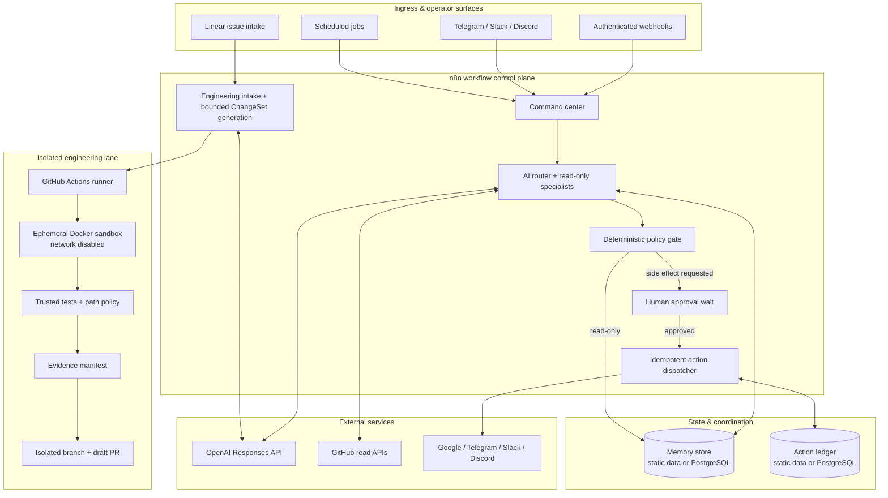

# Workflows-N8N

Workflows-N8N is an **n8n-native automation and agentic operations workflow suite** built around explicit trust boundaries, human-approved side effects, idempotent execution, reusable operator gateways, observability, and a bounded engineering-automation lane.

The repository intentionally remains an n8n workflow project. The JSON exports under `workflows/` are the primary product artifacts; the Python, shell, policy, benchmark, and GitHub Actions code exists to validate, test, and safely operate those workflows.

## What it does

The system provides two complementary paths:

- **Automation control plane** — accepts authenticated operator or scheduled requests, routes them to read-only specialists, applies deterministic policy, waits for human approval when a side effect is requested, and dispatches one narrow approved action through an idempotency ledger.
- **Engineering automation** — accepts selected software tasks, proposes bounded file changes, runs deterministic policy and isolated verification, records evidence, and may publish a **draft pull request** for human review. It has no merge authority.

Core integrations include OpenAI, GitHub, Gmail, Google Calendar, Google Drive, Telegram, Slack, Discord, Linear, and optional PostgreSQL persistence.

## Architecture



The LLM never receives unrestricted provider-write authority, shell authority, credential-management authority, or merge authority. Deterministic code owns the safety policy, verification commands, idempotency rules, and publication gates.

## Repository layout

```text
workflows/
  core/            primary orchestration workflow
  autonomous/      command center, specialists, memory, error handling
  engineering/     engineering intake and reviewed coding workflows
  actions/         human-approved side-effect adapters and dispatcher
  operators/       Telegram, Slack, and Discord gateways
  storage/         PostgreSQL-backed persistence workflows
  schedules/       scheduled read-only automation
  observability/   health and metrics workflows
.agent/             deterministic engineering policy and verification config
agentic_engineering/ isolated execution, evidence, benchmark, and policy helpers
benchmarks/         reproducible simulated controls for the engineering lane
docs/               deployment, security, integration, testing, and subsystem docs
examples/           request/event examples
scripts/            workflow validation and live n8n smoke harness
tests/              unit, safety, and cross-workflow tests
.github/workflows/  CI and controlled engineering runner
```

## Requirements

For repository validation and development:

- Python 3.12 (the CI test target);
- Docker for the live n8n import/boot smoke test and Docker isolation check;
- the repository's pinned n8n runtime target (`2.43.6`) for compatibility validation.

For a deployed n8n instance, configure only the credentials needed by the workflows you import. Typical deployments may require OpenAI, GitHub, Google, Telegram, Slack, Discord, Linear, and PostgreSQL credentials. No provider secret should be committed into workflow JSON or source files.

## Import and deployment

1. Choose the portable workflow-static-data backend or the PostgreSQL persistence backend.
2. Import the read-only specialists.
3. Import the approved action adapters and dispatcher.
4. Import the autonomous command center and bind its sub-workflow IDs.
5. Assign credentials and configure explicit allowlists.
6. Import operator gateways, schedules, and observability workflows as needed.
7. Run repository validation and the live n8n smoke test before publishing workflows.

The exact import/wiring sequence and placeholder list are documented in [`docs/IMPORT_ORDER.md`](docs/IMPORT_ORDER.md).

## Configuration and secrets

The workflow system separates configuration from authority:

- Header Auth protects generic webhook and approval boundaries.
- Provider credentials are configured in n8n credential objects, not hardcoded in JSON.
- Operator gateways use explicit principal/channel allowlists.
- Linear engineering intake re-fetches issue data from the fixed Linear API endpoint before eligibility decisions.
- GitHub read and write paths use separate least-privilege credentials.
- The approved-action dispatcher accepts a fixed action vocabulary; it does not accept arbitrary provider URLs.
- PostgreSQL queries use positional parameters.

See [`docs/SECURITY.md`](docs/SECURITY.md), [`docs/ACTIONS.md`](docs/ACTIONS.md), and [`docs/DISCORD_RELAY.md`](docs/DISCORD_RELAY.md).

## Persistence

Two interchangeable implementations preserve the same workflow contracts:

- portable/default: `workflows/autonomous/05-memory-store.json` + `workflows/actions/55-action-ledger.json` using workflow static data;
- durable: `workflows/storage/06-postgres-memory-store.json` + `workflows/storage/56-postgres-action-ledger.json`.

Use PostgreSQL for multi-worker, restart-resistant, or higher-volume deployments. See [`docs/POSTGRES_BACKEND.md`](docs/POSTGRES_BACKEND.md).

## Approved side effects

A side effect is executed only after an explicit allowlisted action envelope reaches the human-approval path. The signed n8n resume webhook resumes after the operator decision, the dispatcher claims an idempotency key, one narrow adapter executes, and the completion ledger records the result under the original key.

Supported action families include Gmail, Google Calendar, Google Drive, Telegram, Slack, Discord, and constrained GitHub writes. Contract examples are in [`docs/ACTIONS.md`](docs/ACTIONS.md).

## Engineering automation

The optional engineering lane is intentionally narrower than a general-purpose coding agent:

1. selected Linear issues require explicit `agent:auto` authorization and deterministic eligibility;
2. sensitive categories are rejected or escalated;
3. models may return bounded file operations, not shell commands;
4. protected and review-required paths are enforced by repository policy;
5. verification runs in an ephemeral Docker workspace with networking disabled;
6. actual changed paths are checked again after mutation;
7. failing verification prevents publication;
8. successful campaigns may create a **draft** PR and evidence artifact, never merge the PR.

Run the reproducible isolation control with:

```bash
python -m agentic_engineering.isolation_check --mode local
```

Run the simulated benchmark controls with:

```bash
python -m agentic_engineering.benchmark --mode local
```

The benchmark fixtures validate pipeline and safety behavior only; they are not autonomous coding-quality evidence. See [`docs/AGENTIC_ENGINEERING.md`](docs/AGENTIC_ENGINEERING.md).

## Testing and validation

Fast checks:

```bash
python scripts/validate_workflows.py
python scripts/test_contracts.py
python -m unittest discover -s tests -p 'test_agentic_*.py' -v
python -m agentic_engineering.benchmark --mode local
```

Docker isolation check:

```bash
python -m agentic_engineering.isolation_check --mode docker
```

Real n8n import/boot round-trip:

```bash
bash scripts/live_n8n_smoke.sh
```

The live harness imports every workflow into a pinned n8n container, exports them again, checks the workflow-count round trip, restarts n8n, and verifies readiness. CI runs the structural, contract, unit, isolation, and live-runtime checks on the relevant changes.

See [`docs/TESTING.md`](docs/TESTING.md) and [`docs/LIVE_SMOKE.md`](docs/LIVE_SMOKE.md).

## Operating assumptions and current limitations

- Deployment-specific credentials, provider permissions, callback URLs, network access, and allowlists remain the deployer's responsibility.
- The Discord inbound path assumes an upstream relay verifies Discord authenticity before forwarding a normalized event over Header Auth.
- The workflow-static-data persistence option is intended for simpler/single-instance use; durable or multi-worker deployments should use PostgreSQL.
- The engineering benchmark corpus uses canned simulated changes and must not be interpreted as measured autonomous coding quality.
- The engineering lane is deliberately allowlisted and repository-policy-driven rather than a general unrestricted executor.
- Repository validation can establish structural coherence and compatibility with the pinned runtime; it cannot prove that a particular external provider credential is correctly configured.

## Documentation

- [`docs/AUTONOMOUS_SYSTEM.md`](docs/AUTONOMOUS_SYSTEM.md) — control-plane behavior and subsystem boundaries.
- [`docs/IMPORT_ORDER.md`](docs/IMPORT_ORDER.md) — import, wiring, credentials, and publish sequence.
- [`docs/ACTIONS.md`](docs/ACTIONS.md) — approved side-effect contracts.
- [`docs/SECURITY.md`](docs/SECURITY.md) — trust boundaries and security model.
- [`docs/TESTING.md`](docs/TESTING.md) — validation and runtime test strategy.
- [`docs/LIVE_SMOKE.md`](docs/LIVE_SMOKE.md) — pinned n8n import/boot harness.
- [`docs/POSTGRES_BACKEND.md`](docs/POSTGRES_BACKEND.md) — durable persistence option.
- [`docs/DISCORD_RELAY.md`](docs/DISCORD_RELAY.md) — Discord ingress relay contract.
- [`docs/AGENTIC_ENGINEERING.md`](docs/AGENTIC_ENGINEERING.md) — bounded engineering automation lane.

## License

Copyright © 2026 Stamatis-Christos Saridakis. All rights reserved.

This repository is **proprietary source-available software and is not open source**. Access, cloning, and execution are limited to the evaluation, technical-review, security-review, recruitment, and portfolio-assessment purposes described in [`LICENSE`](LICENSE). Production use, commercial use, redistribution, sublicensing, incorporation into another product or service, and derivative use require prior written permission from the copyright owner.
