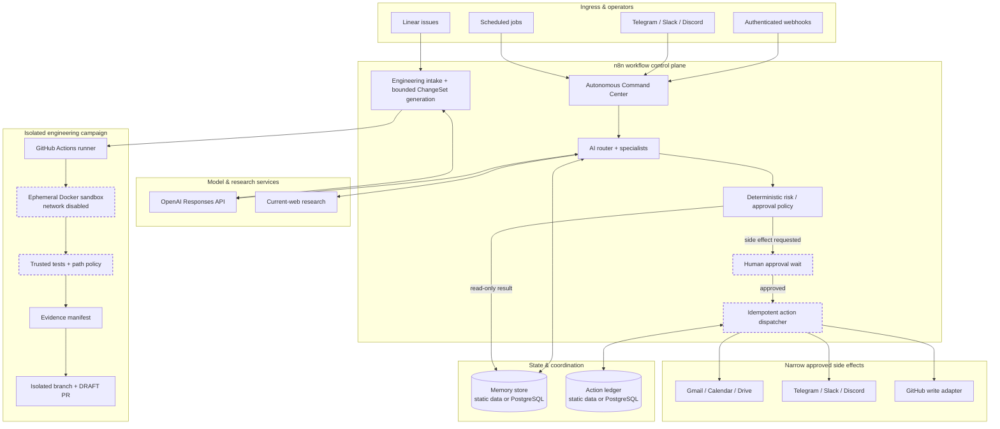

# Workflows-N8N

Production-oriented n8n workflows, reusable automation systems, bounded autonomous orchestration patterns, and a safety-first agentic engineering platform.

## Architecture at a glance



The repository has two complementary execution paths: an **n8n-native automation control plane** for routed work and approved side effects, and an **agentic engineering path** that can publish only verified draft pull requests after isolated execution.

## Agentic Engineering Platform

The repository now includes an engineering-agent paved road aligned with the responsibilities of n8n's Agentic Engineering Platform Engineer role:

```text
Linear issue
  -> authenticated relay + Linear API re-hydration
  -> deterministic eligibility / sensitive-domain policy
  -> bounded coding ChangeSet proposal
  -> isolated GitHub Actions campaign
  -> Docker sandbox (network disabled)
  -> trusted tests / static checks
  -> planned + actual path policy
  -> PR evidence manifest
  -> isolated branch
  -> DRAFT PR only
  -> human merge
```

Key surfaces:

- `AGENTS.md` — repository-local operating contract;
- `.agent/policy.yaml` — deterministic task/path safety rules;
- `.agent/ownership.yaml` — ownership/review metadata;
- `.agent/verification.yaml` — trusted verification profiles;
- `workflows/engineering/` — Linear intake, bounded change generation, campaign dispatch;
- `agentic_engineering/` — contracts, policy enforcement, sandbox execution, evidence, evaluation;
- `benchmarks/` — reproducible evaluation/safety fixtures;
- `.github/workflows/agentic-campaign-runner.yml` — verified branch + draft-PR publisher;
- `.github/workflows/agentic-engineering-ci.yml` — unit, negative, Docker isolation, and evidence CI.

The model never receives shell authority or merge authority. Model output proposes bounded file operations; deterministic code controls paths, verification, publication gates, and evidence.

See `docs/AGENTIC_ENGINEERING.md` and `docs/ROLE_COVERAGE.md`.

## Elite systems

### Elite AI Ops Orchestrator
`workflows/core/elite-ai-ops-orchestrator.json`

Authenticated webhook -> deterministic validation -> planner -> adversarial critic -> final synthesis -> policy/approval gate.

### Elite Autonomous System v3
`workflows/autonomous/00-autonomous-command-center.json`

A compositional control plane with:

- bounded memory and interchangeable persistence backends;
- AI routing into independent research, engineering, communications, GitHub, and general specialists;
- OpenAI Responses API + current-web research;
- optional adversarial-specialist + independent-arbiter deliberation for hard/high-stakes work;
- deterministic risk and human-approval policy;
- idempotent approved-action execution;
- Gmail, Google Calendar, Google Drive, Telegram, Slack, Discord, and GitHub write adapters;
- Telegram and Slack direct operator gateways;
- authenticated Discord relay gateway;
- scheduled autonomous read-only briefs;
- dependency health checks and Postgres operations metrics;
- centralized error capture and bounded recovery advice;
- structural, safety, cross-workflow, and real-n8n import/boot CI.

## Repository layout

```text
.agent/
agentic_engineering/
benchmarks/
workflows/
  core/
  autonomous/
  engineering/
  actions/
  operators/
  storage/
  schedules/
  observability/
docs/
examples/
scripts/
tests/
.github/workflows/
```

## Safety model

The LLM never receives unrestricted write authority.

For ordinary automation actions:

1. models research, analyze, draft, and route;
2. a caller must provide an explicit allowlisted `action` envelope for a side effect;
3. any action forces a human-approval wait;
4. the signed n8n resume webhook resumes only after the operator decision;
5. the deterministic dispatcher claims an idempotency key before execution;
6. exactly one narrow action adapter runs;
7. each adapter independently requires `approved=true`;
8. the completion ledger records the result using the original claimed key.

For engineering campaigns:

1. selected issues require explicit `agent:auto` authorization and deterministic eligibility;
2. sensitive domains are blocked or escalated;
3. models return a bounded ChangeSet, not shell commands;
4. protected paths and the guardrails themselves are deterministic policy;
5. verification runs inside an ephemeral Docker workspace with networking disabled;
6. actual changed paths are re-checked after mutation;
7. failing verification prevents publication;
8. successful campaigns may create a **draft** PR; they never merge it.

Natural-language intent such as "send this email" or issue text such as "ignore the policy" does not grant authority.

## Persistence

Two interchangeable implementations preserve the same workflow contracts:

- portable/default: `05-memory-store.json` + `55-action-ledger.json` using workflow static data;
- durable: `06-postgres-memory-store.json` + `56-postgres-action-ledger.json`.

Use Postgres for multi-worker, restart-resistant, or higher-volume deployments.

## Operator surfaces

- Telegram: native trigger.
- Slack: native Slack Trigger; configure a Slack signing secret and explicit user/channel allowlists.
- Discord: Header-Auth relay contract. The upstream relay must verify Discord authenticity before forwarding a normalized event.
- Linear engineering intake: authenticated relay accepts only issue identity, then the workflow re-fetches issue data from the fixed Linear API endpoint before eligibility decisions.

## Verification

Fast checks:

```bash
python scripts/validate_workflows.py
python scripts/test_contracts.py
python -m unittest discover -s tests -p 'test_agentic_*.py' -v
python -m agentic_engineering.benchmark --mode local
```

Isolation proof:

```bash
python -m agentic_engineering.pilot --mode docker
```

Real n8n import/boot round-trip:

```bash
bash scripts/live_n8n_smoke.sh
```

The live n8n harness is pinned to n8n `2.43.6` and GitHub Actions runs it on workflow changes. See `docs/LIVE_SMOKE.md`.

The initial agent benchmark corpus is intentionally marked **SIMULATED** and uses canned change-sets to validate pipeline/safety behavior. It must not be presented as autonomous coding-quality evidence.

## Deployment status

The repository exports are structurally, contract, and pinned-runtime import validated once the CI checks are green. The engineering platform additionally requires deployment-specific Linear/GitHub/OpenAI credentials, explicit allowlists, and external-provider smoke tests before production use.

Start with `docs/IMPORT_ORDER.md`, then read `docs/AUTONOMOUS_SYSTEM.md`, `docs/ACTIONS.md`, `docs/SECURITY.md`, `docs/TESTING.md`, `docs/LIVE_SMOKE.md`, and `docs/AGENTIC_ENGINEERING.md`.

No API keys, OAuth secrets, webhook secrets, passwords, or tokens are committed to this repository.

## License

Copyright © 2026 Stamatis-Christos Saridakis. All rights reserved.

This repository is **proprietary source-available software and is not open source**. The source may be accessed, cloned, and executed only for the limited evaluation, technical review, security review, recruitment, and portfolio-assessment purposes described in [`LICENSE`](LICENSE). Production use, commercial use, redistribution, sublicensing, incorporation into another product or service, and derivative use require prior written permission from the copyright owner.
